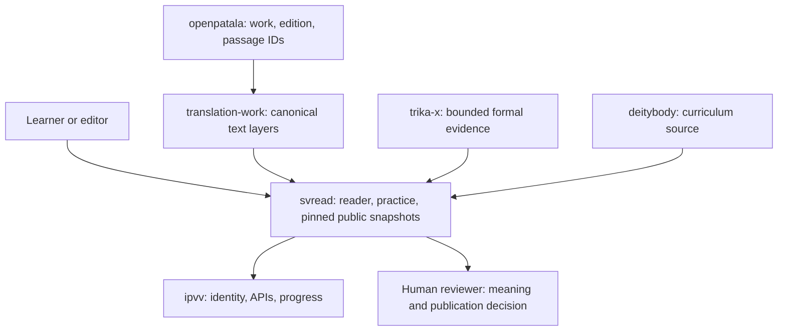

# External strategy: contracts, review, and realistic roadmap

**Snapshot reviewed:** `svread` `df304e0` (2026-11-11), `ipvv/master`
`c2cb6b3`, and open `svread` PR #11 (`6003802`). This is an implementation
specification and review record, not a production approval or scholarly
sign-off. Recheck the referenced heads before implementing.

## Recommendation in one paragraph

Build one dependable study path for a short Sanskrit Śaiva text: identify the
edition and passage, show the Sanskrit accurately, explain words and grammar,
compare translations with attribution, and let a bounded teacher help a reader
work through it. Put source, edition, translation, and review status beside
the text. A learner should be able to get value without an account; accounts
should add private progress. Scholars need a reproducible source trail and a
simple way to correct or annotate it. The site can verify bytes, schemas, and
specified computations; it cannot prove that an interpretation is correct or
that a learner has mastered Sanskrit. Make this small experience trustworthy
before scaling the corpus, building a large tool federation, or training a
model.

## Review of the latest state

### P0 — the merged learning gate is not present in the backend source

`journey.js` calls `/api/wheel/progress`, `/api/wheel/gate/start`, and
`/api/wheel/gate/submit`. The checked `ipvv/master` commit `c2cb6b3` has no
matching routes, no `gate_sessions` table, and no migration `0013` or `0014`;
searching its worker tree also finds no `learner_progress` or
`learner_attempts` schema. The svread gate test tries to read
`../ipvv/worker/src/index.js`, so it depends on an unpinned sibling checkout;
in this workspace it fails at “gate routes present.” The current UI still
labels a signed-in session “scored by the server” when the progress request
fails and defaults the displayed stage to 1.

**Action:** do not describe W1 as shipped or deploy it as a working learning
gate until the worker routes, database migration, worker-owned functional
tests, and deployment revision are all recorded in `ipvv`. Then run an
explicit cross-repo smoke test against the pinned worker revision. In svread,
test only the reader's request/response contract; do not inspect an ambient
`../ipvv` directory.

### P0 — the public pool contains its answer key

`data/wheels/gates.json` is a public, checked-in static asset. All **61/61**
items contain `answer` as well as the prompt and options. The gate test checks
that each answer is one of the choices, but does not check what the public
asset reveals. Anyone can fetch the pool and replay correct choices. The server may
still be the authority that records a score, but this pool cannot support the
“uncheatable” or mastery-certification claim.

**Action:** treat the current pool as public practice material and label its
score as a low-stakes progress check. If a verified assessment is needed,
create an explicitly separate, versioned assessment with unseen variants and
server-held answers; do not call ordinary multiple choice uncheatable. In
either case, measure whether learners understand and retain the forms.

### P1 — latest `main` is not green

The latest Actions run available at this review, `42973083646` for
`df304e0`, failed at `python3 scripts/release_manifest.py`; every later step,
including tests, was skipped. The README changed after the manifest was
generated. In a full checkout, local results were **79 passed, 3 failed, 11
skipped** across 93 Node tests. The three failures were:

1. the external-worker route assertion above;
2. `tests/release-manifest.test.cjs`, because the checked-in release manifest
   is stale;
3. `tests/wiring.test.cjs`, because it requires the literal word `GREEN` from
   `emit_gate_pools.py --check`, although that command correctly exits 0
   silently.

The earlier local run accidentally used a sparse checkout; those omissions
were corrected before reporting these numbers. Node was `v24.22.1` locally;
Actions pins Node 22. The MCP suite was **40 passed, 1 skipped**. In this
follow-up branch, the emitter assertion now accepts a silent exit-0 check, and
the svread client contract no longer reads an ambient sibling checkout. The
optional IPVV source check, when explicitly pointed at current `ipvv/master`,
still fails because the routes are absent. The corrected full Node suite on
this branch is **82 passed, 0 failed, 12 skipped** (94 total); the IPVV check
is an explicit, dependency-labelled skip unless a pinned checkout is supplied.
No server-gate behavior is counted as passed. Independently,
`emit_index_meta.py --check`, `emit_claim_pages.py --check`,
`emit_gate_pools.py --check`, and `seo_check.py` passed; SEO reported 909/909
source hashes, 906 claim URLs, and the Ghaṭakarpara English hold honored. The
Ghaṭakarpara HTML and Markdown claim pages now withhold English. Negative
fixtures for altered source, stale English, changed source plus manifest,
missing layer, and unmappable L2 pass. Those are real improvements over the
earlier review. After separating the client test from the optional worker
check, the focused gate/wiring run was **15 passed, 0 failed, 5 skipped**. When
`IPVV_ROOT` was explicitly set to the current IPVV checkout, the optional
integration check reported **4 passed, 1 failed** at “gate routes present.”

**This follow-up fixes** the stale manifest, the quiet-check assertion, and
the ambient sibling dependency. The remaining action is to implement and test
W1 in IPVV, then run the pinned cross-repo smoke test. Keep W1 marked
incomplete until that backend exists. A green svread-only suite is not
evidence that the remote worker works.

### P1 — translation provenance remains incomplete

The claim surface now labels machine renderings and editorial holds honestly.
That does not resolve work-level attribution: some pages still say “edition
unrecorded,” witness `UNPINNED`, or licence verification pending. Hashes show
which bytes were handled; they do not establish who authored them, which
edition they came from, or whether redistribution is allowed. The separate
comparison pilot in PR #11 correctly avoids copying external translations,
but is open, based on an older `main`, and GitHub reports it unmergeable. A
three-way merge preview confirms conflicts in `data/release-manifest.json`,
`styles.css`, and `sw.js`.

**Action:** preserve PR #11's comparison work, rebase it on current `main`,
resolve those conflicts, rerun its tests, and keep alternative translations
linked unless the exact translation licence permits the proposed reuse.

## 1. Integration specification

### A. Learning gate and progress (IPVV owns runtime)

Use a server-scored, account-bound progress record. The ordinary public wheel
is practice, not identity verification or evidence of mastery.

```json
POST /api/wheel/gate/start
{"curriculum":"word"}

200
{"session_id":"opaque-id","expires_at":"UTC timestamp",
 "pool_revision":"sha256:…","items":[
   {"item_id":"w1:kim","prompt":"…","options":["…","…","…","…"]}
 ]}

POST /api/wheel/gate/submit
{"session_id":"opaque-id","answers":[{"item_id":"w1:kim","choice":"…"}]}

200
{"receipt_id":"…","score":18,"total":20,"passed":true,
 "next_stage":2,"progress_version":7}
```

Required invariants:

- Derive the user's eligible stage from stored progress. Never trust the client
  to choose or unlock a later stage.
- Bind each opaque session to one authenticated user, curriculum, stage, pool
  revision, item set, server-side key, and expiry. Reject cross-user,
  cross-stage, missing, duplicate, extra, and malformed answers.
- Use server time and a cryptographically secure shuffle. Never return or log
  the answer key. Return the same receipt for an identical retry after a lost
  response; reject a different replay with 409 and no second progress write.
- Score and monotonically advance progress in one database-atomic operation.
  Enforce attempt limits server-side. An expired session changes no progress.
- Cookie-authenticated writes require CSRF/Origin protection. CORS is limited
  to the actual site origins. Bearer credentials never appear in a URL.
- Keep the receipt minimal: account, curriculum/stage, pool revision, score,
  outcome, scorer version, timestamp. Do not retain answer text unless there
  is a documented learning need and a retention policy.
- Render “server-scored” only when `/progress` succeeds and a valid gate
  session is available. On failure, show a clear unavailable state, not a
  default stage or a success-like label.

The 20-question, 18-to-pass threshold is a product choice, not a Sanskrit
learning standard. Retain it only if learner trials show it is useful. Public
answer keys mean this mode must be described as a practice progress check.

### B. Mechanics certificates (trika-x owns formal artifacts)

Use certificates to identify a bounded computation, not to label a form or
translation “true.” A certificate must bind:

- stable form/claim ID and exact input/output;
- each rule step and its stated conditions;
- source pack revision and source-byte digest;
- rule-slice revision, Lean version, command, and actual successful run receipt;
- canonical certificate digest (computed over all fields except the digest
  field itself).

Use separate statuses such as `UNVERIFIED`, `CHECKED`, and `FAILED`. The
consumer re-hashes the exact certificate and source pack. No `lean_ok: true`
flag by itself is a proof receipt. A Lean proof establishes only the theorem
encoded in that Lean development; a rule inventory or hand-authored lookup
table is not a derivation from Pāṇinian grammar. Keep the three stamps
separate: bytes, mechanics, and human meaning.

### C. MCP and OAuth (federation owns tools; IPVV owns identity)

- Start with a small, read-only, allowlisted tool set: resolve a work/passage,
  retrieve a pinned source bundle, fetch a reviewed translation or explicitly
  labelled draft, and explain a listed form. Do not expose all 104 tools just
  because the federation can enumerate them.
- Tool descriptions state source, review status, licence, and failure behavior.
  Missing children return explicit unavailable results; partial results never
  masquerade as complete.
- Keep the HTTP bridge beside the federation runtime (trika-x or a dedicated
  service), not in the static svread site. IPVV issues and revokes user
  credentials. The bridge enforces per-tool scopes; no duplicate token system.
- `initialize` and tool metadata may be public. User content and progress
  require authorization. Never put access tokens or write arguments in query
  strings. If a `/call` convenience endpoint exists, use POST for calls and
  return the same provenance/status envelope as MCP.
- Implement delegated OAuth with exact redirect URIs, PKCE, state validation,
  short-lived access tokens, revocation, and least privilege. First write
  permission, if justified at all, is progress-only after explicit consent.
  Translation edits, endorsements, and publication remain human-controlled.
- Don't hardcode client subscription tiers into the API. Require the actual
  delegated scope and user consent for every write.

### D. Translation factory (translation-work owns canonical layers)

One job creates a new candidate revision; it never overwrites a signed or
published revision:

```json
{"job_id":"…","work_id":"…","edition_id":"…","passage_id":"…",
 "input_revision":"sha256:…","requested_layer":"l2",
 "model":"…","model_revision":"…","prompt_sha":"…",
 "license_id":"…","output_revision":"sha256:…","status":"BLOCKED"}
```

Each layer consumes pinned parent revisions. A failed gate propagates
`BLOCKED`; no later layer, reader bundle, claim page, or public export can
override it. Retries with the same job and inputs are idempotent. A human
review produces a separate signed decision referencing the exact revision;
only that decision can mark a translation reviewed. Publication is a distinct,
explicit approval event. A private candidate preview is acceptable; public
bundle rendering and release require approval. Nothing auto-signs, auto-renders
into a public page, or publishes.

### E. Scope and failure envelope

All public outputs carry stable work/edition/passage IDs, exact revisions,
authorship/attribution, licence status, and review status. Missing IDs,
unverified rights, stale inputs, failed tests, unavailable dependencies, or
ambiguous alignment withhold the affected English output. Preserve the
original Sanskrit bytes; normalization is a separate derived field.

## 2. High-level test strategy

| Layer | Required checks | Where it runs |
|---|---|---|
| Unit | Parsers, state transitions, canonical hashes, score boundaries, renderer escaping, no answer leakage, licence decisions | Each owning repo's CI |
| Contract | Exact request/response JSON, schema versions, error codes, source and revision identities | Provider and consumer tests from pinned fixtures |
| Functional | Real Worker module with D1 test adapter; 17/18/20 scoring, auth, expiry, isolation, rate limit, replay, concurrency | IPVV CI; staging D1 smoke before release |
| Browser | Sign-in, local unverified mode, gate fail state, reading, compare, notes, mobile layout and keyboard use | PR browser suite, then staging smoke |
| Live | Health and read-only queries against pinned release; no synthetic score, write, deploy, or publish | Manual release checklist / scheduled monitoring |

Required W1 negative cases: unauthenticated start/submit; request for an
unearned stage; answer from a different session; omitted/duplicate/extra item;
17/20 fails and 18/20 passes; expired session; identical retry returns one
receipt; altered replay changes nothing; two concurrent submissions unlock at
most once; one user's session cannot affect another; pool revision mismatch
fails closed. The D1 adapter should mimic the SQL actually used, and a staging
test should verify the same transaction semantics against the deployed D1.

Required W2 negatives: mutate source bytes, an intermediate form, rule
conditions, toolchain version, or run receipt; every mismatch must fail.
Required W3 negatives: wrong scope, revoked/expired token, invalid redirect,
CSRF, oversized body, timeout, child outage, and query-string secret. Required
W5/W6: held-out evaluation set never enters prompts/training, licence
restrictions block loading, signed-data provenance is exact, and results
include a human baseline. Required W7: changed parent revision invalidates the
job; retries never overwrite; `BLOCKED` cannot be exported.

CI policy:

- A clean clone of the target repo must run its required tests without `/root`
  paths or unpinned sibling folders. External integration jobs clone exact
  revisions and state those revisions in logs.
- Keep one test per emitter/dependency. Skip only the test whose declared
  optional dependency is absent, with a precise reason. Never call `skip()` in
  a way that hides later assertions. Quiet `--check` commands pass on exit 0;
  success must not depend on printing a magic word.
- CI checks generated outputs but does not rewrite them. The commit author
  regenerates deterministic outputs, then regenerates the release manifest
  last. Fail CI on stale output.
- Keep scheduled network, staging, or benchmark checks separate from
  deterministic pull-request tests. A scheduled failure must still create an
  actionable report.

## 3. Cross-repository strategy

| Concern | Canonical owner | Consumer boundary |
|---|---|---|
| Reader, public pages, static snapshots, display labels | `svread` | Reads pinned exports; never edits source layers |
| Identity, API auth, learner progress, OAuth token issue/revoke | `ipvv` | Owns routes, migrations, session policy, backend tests |
| Sanskrit passage layers, translation gates, signed revisions, factory jobs | `translation-work` | Canonical text/layer store; read-only to other lanes |
| Formal models, Lean slices, federation tool catalog | `trika-x` | Exports bounded evidence and versioned tool schemas |
| Work, edition, passage identity | `openpatala` | Stable IDs; it does not author English translation layers |
| Curriculum cards and Mātṛkā source | `deitybody` | svread vendors a licensed, hash-pinned snapshot |
| Source/book metadata | `bookfactory` | Bibliographic discovery and citation, not translation approval |
| Media/audio products | `videofactory` | Versioned assets with their own attribution and licence |
| Shared login implementation | `satsang` | Reuse through the IPVV auth boundary; don't copy session logic |

Vendoring rules:

- Prefer stable IDs and links. Copy a snapshot only when its licence permits
  redistribution and the source revision, licence, attribution, and SHA-256
  are recorded. Keep source bytes separate from normalized/converted forms.
- Do not bundle restricted or uncertain material. A public download is not a
  republication licence; a hash is not permission. Personal annotations remain
  private and are not sent to models without explicit selection and consent.
- Keep the named Kaggle chant datasets and kernels read-only. Do not revise,
  publish, or train on them without a separate explicit owner instruction.
- During local development, sibling checkouts are optional inputs controlled
  by explicit environment variables. In integration CI, pin each sibling to a
  commit; never use “whatever happens to be at `/root`.”
- One repo owns each write path. Consumers submit issues or a schema proposal;
  they do not edit another lane's canonical files or regenerate its outputs.
- Change order: identity/schema proposal → owner implementation and tests →
  versioned export → consumer adapter and fixtures → end-to-end test → deploy.
  Do not merge parallel branches that both rewrite `sw.js` or the release
  manifest without regenerating and verifying the final combined tree.

## 4. Reconciled roadmap

| Milestone | Work and reason | Exit condition |
|---|---|---|
| M0 — make claims match code | Fix stale manifest and emitter assertion; move worker tests to IPVV; add W1 routes/migration; stop saying “uncheatable”; show an honest unavailable state | Main CI passes; worker code and migration are on IPVV main; pinned staging smoke proves the path |
| M1 — one trusted reading | Choose one short text and exact edition; verify complete passage mapping, rights, author credits, and source/transliteration; label every draft | Two verses reviewed by a Sanskrit reader independent of the drafter; unresolved readings remain visible |
| M2 — prove reader value | Use the comparison pilot as a candidate; test with 3–5 learners and at least one Sanskrit reviewer; observe find/parse/compare/cite tasks | Task completion, comprehension errors, editorial corrections, and user friction are recorded; no page-count success metric |
| M3 — practice loop | Add the curriculum surface only after W1's service contract is live; local practice remains useful without account; server progress is optional and explicitly low-stakes | Learners can practise, see feedback, return later, and understand what their score does and does not mean |
| M4 — read-only teacher access | Expose a small, source-bounded MCP catalogue after M1/M2; tools return passage, edition, status, and citation with every answer | Fresh-session tool tests, rights tests, and user task trials pass; unavailable sources are explicit |
| M5 — narrow writes | Add progress-only delegated writes if users ask for sync; keep drafts, endorsements, and publishing private/approval-gated | Consent, scope, revocation, account isolation, and audit tests pass |
| M6 — optional training/factory | Start only if the measured baseline shows a repeated bottleneck and licensed, human-signed data exists | Held-out quality improves against a human/previous-model baseline without changing source meaning; otherwise defer |

Defer broad LoRA, bulk translation, the 104-tool public federation, and
automated publication. They add cost and operational risk before there is
evidence that they help a reader. The public product should be a focused
reading-and-practice companion, not a claim that AI has solved Trika or
Sanskrit scholarship.

## 5. Repository/concerns split



The arrows into svread are versioned exports, not runtime permission to rewrite
the upstream repository. `svread` owns the browser experience; IPVV owns
identity and progress; translation-work owns text and translation revisions;
trika-x owns formal artifacts; Open Patala owns identifiers. Human review
remains a separate authority from all of them.

### User-facing measure of usefulness

The system is useful if a beginner can locate a real passage, understand its
basic grammar, see where translations differ, and cite the version they used;
a translator can spot a source-alignment problem before publication; and a
teacher can assign practice without pretending an automated score is
initiation, competence, or spiritual authority. Track those outcomes with
small user trials and reviewers' corrections. Do not use generated page count,
tool count, formal theorem count, or search impressions as substitutes.
